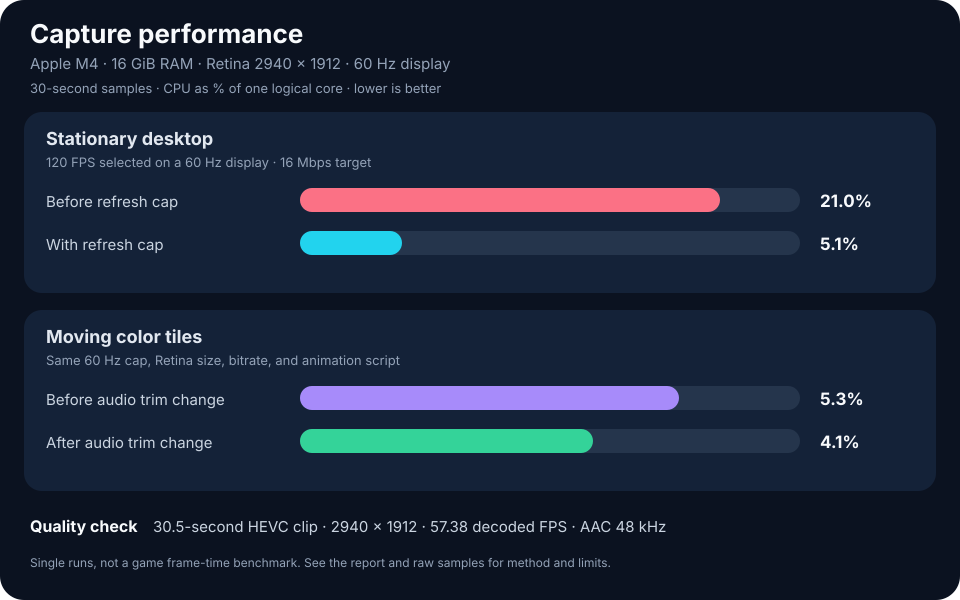

# Snip capture measurements — 2026-10-13



## Test setup

| Item | Value |
| --- | --- |
| Mac | Apple M4, 16 GiB unified memory, macOS 27.0.1 |
| Display | 2940 × 1912 physical pixels, 1470 × 956 scaled mode, 60 Hz |
| Capture | Retina, 120 FPS selected, 16 Mbps HEVC target, 30-second history, 1024 MB buffer cap |
| Sources | System audio on; all apps included for video and sound |
| Color | Neutral brightness, contrast, and saturation |
| Sampling | 30 seconds per run, `ps` every 0.5 seconds |

CPU values are percent of **one logical CPU**: 100% is one fully used logical core. RSS is resident memory for Snip alone and excludes macOS capture and encoding services. The raw JSON contains every reading, system details, settings, and clip metadata. ScreenCaptureKit start/stop messages in the system log confirmed capture state for the later runs.

## Process cost

| 30-second observation | CPU median | CPU p95 | CPU max | RSS median | RSS max |
| --- | ---: | ---: | ---: | ---: | ---: |
| Stationary, requested 120 FPS before display cap | 21.0% | 27.62% | 29.0% | 151.41 MiB | 151.75 MiB |
| Stationary, capped to 60 FPS | 5.1% | 5.71% | 6.2% | 134.36 MiB | 134.50 MiB |
| Paused after earlier capture | 0.0% | 0.5% | 2.4% | 195.11 MiB | 195.11 MiB |
| Stationary after one pause/resume | 4.8% | 10.37% | 16.5% | 212.75 MiB | 213.55 MiB |
| Moving tiles before audio trim change | 5.3% | 6.0% | 6.3% | 154.94 MiB | 154.94 MiB |
| Stationary with audio trim change | 4.15% | 4.6% | 4.9% | 148.34 MiB | 184.08 MiB |
| Moving tiles with audio trim change | 4.1% | 4.6% | 4.7% | 148.83 MiB | 148.84 MiB |

The first optimization caps ScreenCaptureKit's requested frame interval and VideoToolbox's expected frame rate to the selected display's refresh rate. On this 60 Hz display, 120 FPS selected resolves to 60 FPS. Median Snip CPU was **21.0% before** and **5.1% after** in single stationary desktop observations.

A five-second `/usr/bin/sample` profile then showed repeated audio buffer trimming copying the packet array. The second optimization advances an audio head index and compacts discarded packets in batches, bounded by 8 MiB of stale audio. A second five-second profile no longer showed the array copy under audio trimming. On the same moving tile test script, median Snip CPU was **5.3% before** and **4.1% after**, a 22.6% difference in those two observations. Median RSS was **154.94 MiB before** and **148.83 MiB after**. The clip encoder and image path did not change in this second optimization.

These are **one run per condition**, not controlled causal estimates or promised speedups. The screen, process lifetime, other activity, and OS scheduling varied. Paused RSS retained previous allocations and should not be read as idle startup memory. The configured buffer cap bounds stored sample bytes, not the entire process or ScreenCaptureKit services. The highest observed process RSS here, 213.55 MiB, remained below 1 GiB.

## Captured clip quality

The moving scene was a native window with 36 animated color tiles, run by [benchmark-scene.swift](../scripts/benchmark-scene.swift). It ran during each 30-second process sample, and a clip was saved using Snip's hotkey immediately afterward. `ffprobe` inspected the private clips; only metadata was committed.

| Clip measurement | Before audio trim change | After audio trim change |
| --- | ---: | ---: |
| Duration | 30.784 s | 30.479 s |
| Video size | 2940 × 1912 | 2940 × 1912 |
| Codec and pixel format | HEVC Main, `yuv420p` | HEVC Main, `yuv420p` |
| Actual whole-file bitrate | 16.50 Mbps | 15.86 Mbps |
| Decoded frames | 1,762 | 1,749 |
| Decoded frames / duration | 57.24 FPS | 57.38 FPS |
| Median / p95 frame gap | 16.67 / 16.67 ms | 16.67 / 16.67 ms |
| Long gaps (>1.5 × 60 FPS interval) | 84 | 78 |
| Maximum frame gap | 33.33 ms | 33.33 ms |
| Audio | AAC, 48 kHz | AAC, 48 kHz |

The encoded pixel dimensions match the display's **physical Retina resolution**, rather than the 1470 × 956 logical mode. The audio buffer change preserved that size, codec, audio format, and observed frame cadence. Average decoded frame rate is below nominal 60 FPS in both clips; each has some 33.33 ms gaps. These observations do not distinguish app frame delivery, capture scheduling, encoder behavior, and scene changes. Whole-file bitrate includes audio and container overhead; it is not a direct measure of visual fidelity. There was no synchronized lossless reference for PSNR or SSIM, and no game frame-time measurement.

## Reproduce

Install and run Snip with screen recording permission, then sample its process:

```sh
python3 scripts/benchmark.py sample --label my-run --seconds 30 --interval 0.5 --output benchmarks/raw/my-run.json
```

If running a development copy from `dist` rather than `/Applications`, pass its PID with `--pid`. To repeat the moving workload, start `swift scripts/benchmark-scene.swift` and begin sampling while its window is visible. The window closes after 50 seconds. To inspect an exported clip, install `ffprobe` and run:

```sh
python3 scripts/benchmark.py inspect --output benchmarks/raw/my-run.json --clip /path/to/clip.mov
```

The `inspect` command reads metadata and frame timestamps, not image pixels. Confirm Snip shows **Recording** before sampling; a permission prompt or paused state can otherwise produce misleadingly low CPU values.

Raw samples: [before refresh cap](raw/retina-120-before.json) · [after refresh cap](raw/retina-120-after.json) · [paused](raw/paused-baseline.json) · [stationary repeat](raw/active-stationary-repeat-1.json) · [moving before audio change](raw/active-moving-tiles.json) · [stationary after audio change](raw/optimized-stationary.json) · [moving after audio change](raw/optimized-moving-tiles.json).
